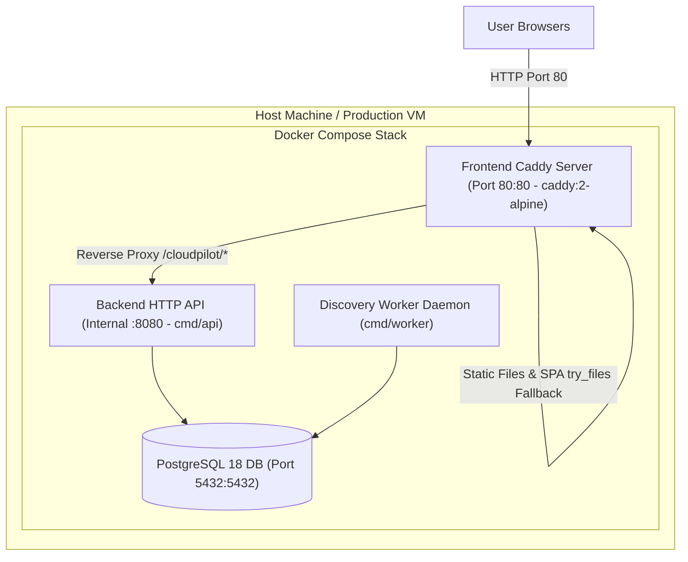

# CloudPilot Docker Deployment & Caddy Gateway

This directory contains the multi-container Docker Compose orchestration and Caddy reverse proxy configuration for CloudPilot.

---

## 1. Container Topology



---

## 2. Services Overview

| Service | Image / Build | Port Mapping | Description |
| :--- | :--- | :--- | :--- |
| **`frontend`** | `caddy:2-alpine` (`../../frontend`) | `80:80` | Serves static React UI and acts as the reverse-proxy gateway for `/cloudpilot/*`. |
| **`api`** | Go Alpine (`../../backend`) | Internal `8080` | Core modular monolith HTTP API. Shielded behind Caddy (not exposed to host). |
| **`worker`** | Go Alpine (`../../backend`) | None (daemon) | Autonomous multi-cloud resource discovery and policy audit worker. |
| **`postgres`** | `postgres:18-alpine` | `5432:5432` | Multi-tenant PostgreSQL database. |

---

## 3. Caddy Reverse Proxy Architecture (`frontend/Caddyfile`)

Caddy operates on standard port `80` as the single public entrypoint:

```caddy
{
    admin 127.0.0.1:2019
    auto_https off
}

:80 {
    root * /usr/share/caddy
    encode gzip zstd

    # Route backend API & auth internally to http://api:8080
    handle /cloudpilot/* {
        reverse_proxy http://api:8080
    }

    # Serve static frontend SPA
    handle {
        try_files {path} /index.html
        file_server
    }
}
```

---

## 4. Quickstart with Docker Compose

From the `deployments/docker` directory:

```bash
# 1. Prepare environment configuration
cp .env.example .env

# 2. Build and launch all containers
docker compose up --build -d
```

*(Or from the repository root: `docker compose -f deployments/docker/docker-compose.yml --env-file deployments/docker/.env up --build -d`)*

### Docker Service Endpoints

- **CloudPilot Web App**: `http://localhost`
- **Dashboard**: `http://localhost/dashboard`
- **Health Check**: `http://localhost/cloudpilot/healthz`
- **OAuth Callback**: `http://localhost/cloudpilot/auth/callback`
- **PostgreSQL**: `localhost:5432`

---

## 5. Operations & Logs

### View container logs
```bash
# Stream logs for all services
docker compose -f deployments/docker/docker-compose.yml logs -f

# View backend API logs
docker compose -f deployments/docker/docker-compose.yml logs -f api

# View discovery worker logs
docker compose -f deployments/docker/docker-compose.yml logs -f worker
```

### Stop the stack
```bash
docker compose -f deployments/docker/docker-compose.yml down
```

### Reset database volume
```bash
docker compose -f deployments/docker/docker-compose.yml down -v
```
