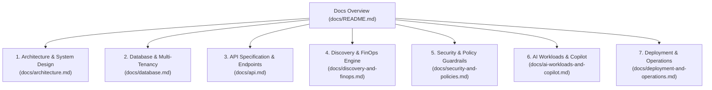

# CloudPilot Documentation

Welcome to the CloudPilot documentation. CloudPilot is an enterprise-grade autonomous multi-cloud governance, FinOps, and AI workload observability platform.

This directory contains in-depth documentation covering architecture, database design, API contracts, cloud discovery, security frameworks, and operations.

---

## Documentation Navigation

---

## Documents Directory

| Document | Focus & Scope |
| :--- | :--- |
| **[Architecture & System Design](architecture.md)** | Modular monolith layout, Go backend, background worker, React 19 UI, and communication flows. |
| **[Database & Multi-Tenancy](database.md)** | PostgreSQL schema, entity relationships, embedded migrations (`001`-`008`), and strict workspace isolation. |
| **[API Specification](api.md)** | Comprehensive API documentation for all REST endpoints across all 9 domain modules. |
| **[Discovery & FinOps Engine](discovery-and-finops.md)** | AWS, GCP, and Azure discovery scanners, sync lifecycle, 30-day cost timeseries, and budget tracking. |
| **[Security & Policy Guardrails](security-and-policies.md)** | CIS Benchmarks, SOC 2, HIPAA, AI Safety rules, finding resolution lifecycle, and OIDC cookie auth. |
| **[AI Workloads & Copilot](ai-workloads-and-copilot.md)** | Bedrock, SageMaker, Vertex AI, Azure OpenAI telemetry, guardrails evaluation, and pluggable AI Copilot. |
| **[Deployment & Operations](deployment-and-operations.md)** | Docker Compose configuration, production environment variables, local setup, and health checks. |
