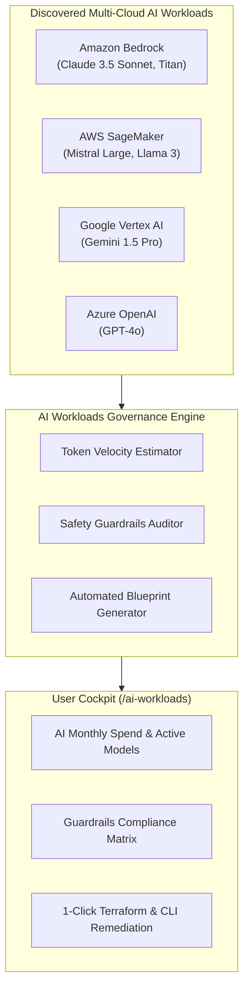
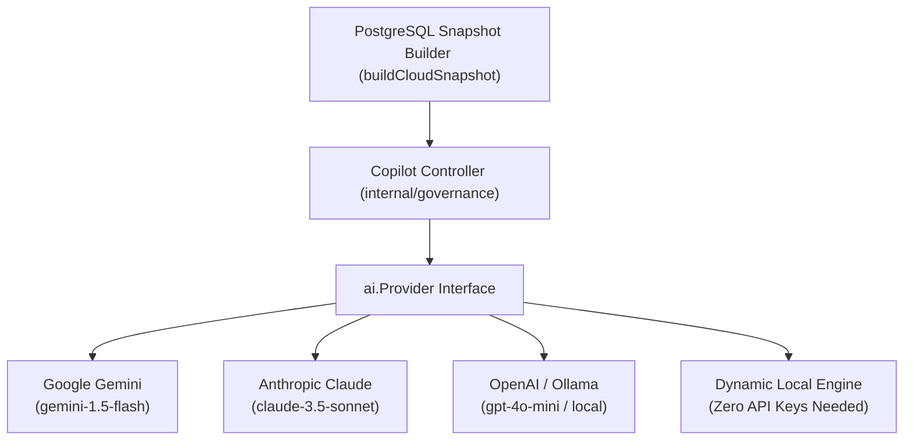

# AI Workloads Hub & Autonomous Copilot

CloudPilot provides dedicated observability, security governance, and autonomous optimization for enterprise AI models, alongside an extensible, vendor-agnostic AI Copilot.

---

## 1. AI Workloads Hub (`/ai-workloads`)

As organizations adopt foundation models, AI infrastructure costs and compliance risks scale rapidly. The AI Workloads Hub provides deep observability into model deployments.



### 1.1 Supported Foundation Models & Platforms
- **Amazon Bedrock**: Anthropic Claude 3.5 Sonnet, Amazon Titan Text / Embeddings.
- **AWS SageMaker**: Managed real-time endpoints (Mistral Large, Meta Llama 3).
- **Google Vertex AI**: Gemini 1.5 Pro, Gemini 1.5 Flash.
- **Azure OpenAI**: GPT-4o, GPT-4o-mini deployments.

### 1.2 Monitored Guardrails
Every AI model is continuously evaluated against three core enterprise safety criteria:
1. **PII Masking & Filtering**: Evaluates whether input/output prompts have automated personally identifiable information redaction enabled.
2. **Model Audit Logging**: Verifies cloud invocation logs and prompts are retained for compliance audits.
3. **KMS CMK Encryption**: Ensures custom encryption keys protect stored model weights and cached inference data.

### 1.3 Automated Blueprint Remediation
Users can click **"Remediate"** on any flagged AI workload to inspect validated **Terraform (HCL)** and **Cloud CLI** deployment code that enables missing guardrails without breaking running inference applications.

---

## 2. Autonomous AI Copilot Engine

The AI Copilot operates via an extensible Go provider abstraction (`internal/ai`), allowing organizations to leverage their preferred LLM or run completely local inference.

### 2.1 Provider Architecture



### 2.2 Go Provider Interface
```go
type Provider interface {
    Name() string
    GenerateInsights(ctx context.Context, snapshot CloudSnapshot) ([]Insight, error)
    Chat(ctx context.Context, messages []ChatMessage, snapshot CloudSnapshot) (string, error)
    ExplainFinding(ctx context.Context, finding FindingContext) (string, error)
}
```

### 2.3 Provider Configuration (`.env`)
```env
# Switch inference backend with zero code changes:
AI_PROVIDER=gemini        # 'gemini' | 'claude' | 'openai' | 'mock'
AI_API_KEY=your-api-key   # Required for Gemini, Claude, or OpenAI
AI_MODEL=gemini-1.5-flash # Model identifier
AI_BASE_URL=              # Optional custom endpoint (e.g. http://localhost:11434/v1 for Ollama)
```

---

## 3. Dynamic Database Snapshot & Zero-State Handling

To guarantee that the AI Copilot never outputs hallucinated metrics or leaks data across tenants, CloudPilot uses `buildCloudSnapshot`:

1. **Active Organization Querying**: Queries PostgreSQL for the active workspace's open security findings (`policy_findings`), foundation models, and top-cost assets.
2. **Empty Workspace Protection**: If `snapshot.TotalResources == 0`, `GenerateInsights` returns `[]` (empty list). The dashboard displays a clean zero-state without fake recommendations.
3. **Dynamic Synthesis**: When resources exist in the database, insights and chat responses cite the actual names, providers, and costs of resources stored in PostgreSQL.
