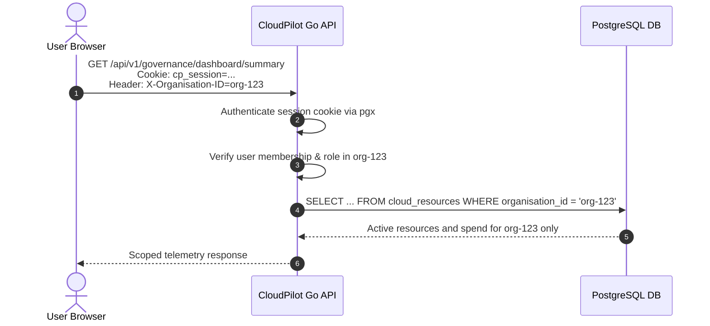

# Architecture & System Design

CloudPilot is designed as a **high-performance Go modular monolith** paired with an autonomous background discovery worker, a multi-tenant PostgreSQL database, and a responsive **React 19** single-page application.

---

## 1. Architectural Principles

1. **Modular Monolith over Microservices**: All domain boundaries are packaged into internal Go packages (`internal/auth`, `internal/governance`, `internal/discovery`, `internal/policy`, `internal/finops`, `internal/integrations`, `internal/ai`). They communicate via in-memory interfaces while maintaining strict package encapsulation.
2. **PostgreSQL as the Single Source of Truth**: Every dashboard KPI, spend breakdown, inventory row, and Copilot insight is derived strictly from PostgreSQL. No static mock arrays or client-side caching fallbacks are permitted.
3. **Strict Multi-Tenant Workspace Isolation**: Every cloud resource, account, budget, policy finding, integration, and audit event belongs to an `organisation_id`. API queries enforce tenant boundaries via authenticated session claims.
4. **Zero-Trust Client Authentication**: Pure OIDC Authorization Code Flow with PKCE. Tokens are kept in secure, Host-Only `HttpOnly` cookies. No JWTs or sensitive tokens are stored in `localStorage`.
5. **Decoupled Autonomous Worker**: Heavy discovery operations and continuous policy evaluation execute in an independent background worker (`cmd/worker`), preventing long-running cloud API calls from blocking user-facing HTTP request threads.

---

## 2. High-Level System Architecture

```mermaid
flowchart TD
    subgraph Client["Frontend Client (React 19 + TanStack)"]
        UI_Dash["Dashboard (/dashboard)"]
        UI_Inv["Inventory (/inventory)"]
        UI_AI["AI Workloads (/ai-workloads)"]
        UI_Costs["FinOps & Costs (/costs)"]
        UI_Policies["Policies (/policies)"]
        UI_Teams["Teams & RBAC (/teams)"]
        UI_Integrations["Integrations (/integrations)"]
        UI_Settings["Settings (/settings)"]
        UI_Copilot["Copilot Drawer (⌘K)"]
    end

    subgraph BackendAPI["Backend HTTP API (cmd/api - Port 8080)"]
        Router["Chi HTTP Router & CORS Middleware"]
        AuthMid["OIDC & Session Authentication Middleware"]
        
        subgraph Domains["Internal Domain Modules"]
            Auth["internal/auth"]
            Org["internal/organisations"]
            Gov["internal/governance"]
            FinOps["internal/finops"]
            Policy["internal/policy"]
            Integrations["internal/integrations"]
            Audit["internal/audit"]
            AI["internal/ai"]
        end
    end

    subgraph WorkerDaemon["Discovery Worker (cmd/worker)"]
        Scheduler["Cron / Interval Scheduler"]
        DiscoveryEngine["internal/discovery (AWS, GCP, Azure Scanners)"]
        PolicyRunner["internal/policy Evaluator"]
    end

    subgraph Storage["PostgreSQL 16 Database"]
        PG[("cloudpilot database")]
    end

    subgraph ExternalServices["External Cloud & AI Providers"]
        AWS["AWS APIs (EC2, S3, RDS, Bedrock, SageMaker)"]
        GCP["GCP APIs (Compute, Storage, Cloud SQL, Vertex AI)"]
        Azure["Azure APIs (VMs, Blob, Azure OpenAI)"]
        LLM["AI Providers (Gemini / Claude / OpenAI)"]
        Webhooks["Alert Targets (Slack, Teams, Discord)"]
    end

    Client -->|HTTPS + HttpOnly Cookies (credentials: include)| Router
    Router --> AuthMid --> Domains
    Domains --> PG
    AI --> LLM
    Integrations --> Webhooks

    WorkerDaemon --> DiscoveryEngine & PolicyRunner
    DiscoveryEngine --> AWS & GCP & Azure
    DiscoveryEngine --> PG
    PolicyRunner --> PG
```

---

## 3. Backend Architecture (`backend/`)

The backend is built with Go 1.26 and organized into domain-driven packages:

| Package | Responsibility |
| :--- | :--- |
| `cmd/api/` | Application entry point: initializes PostgreSQL connection pool (`pgxpool`), applies embedded migrations, registers routes, and starts HTTP server on `:8080`. |
| `cmd/worker/` | Background process: executes scheduled cloud discovery jobs, evaluates compliance policies, and updates account synchronization statuses. |
| `internal/auth/` | OIDC Authorization Code Flow with PKCE, database session management, secure cookie issuing, and tenant context extraction. |
| `internal/organisations/` | Multi-tenant organization workspaces, member roles (`owner`, `admin`, `member`), team invitations, and role management. |
| `internal/governance/` | Executive dashboard summaries, multi-cloud spend distribution calculations, cloud inventory listing, and AI model telemetry. |
| `internal/discovery/` | Multi-cloud discovery scanners (AWS, GCP, Azure) normalizing compute, storage, database, and AI assets into unified records. |
| `internal/policy/` | Policy evaluation engine testing discovered assets against CIS Benchmarks, SOC 2, HIPAA, and AI Safety rules. |
| `internal/finops/` | 30-day historical cost aggregation, spend forecasting, cost anomaly spike detection, and budget enforcement. |
| `internal/integrations/` | Webhook dispatch pipeline for Slack, Microsoft Teams, Discord, and custom HTTPS webhooks. |
| `internal/ai/` | Pluggable AI engine supporting Google Gemini, Anthropic Claude, OpenAI, and dynamic PostgreSQL-driven local inference. |
| `internal/audit/` | Immutable append-only audit event logging capturing security and administrative actions. |
| `internal/migrations/` | Embedded SQL migration runner automatically updating database schemas on startup. |

---

## 4. Frontend Architecture (`frontend/`)

The frontend is a modern SPA powered by React 19, TypeScript, and Vite:

- **Routing**: TanStack Router with type-safe route trees, layout shells (`AppShell`), and authentication guards (`AuthGuard`).
- **Server State**: TanStack Query (`@tanstack/react-query`) with automatic background refetching, mutation triggers, and workspace-scoped query keys (`['module', activeOrgId]`).
- **Client State**: Lightweight Zustand stores:
  - `auth.store.ts`: Current user profile and session status.
  - `workspace.store.ts`: Active workspace context and organization picker state.
- **Styling**: Tailwind CSS v4 with dark/light mode variables, class variance authority (`cva`), and Radix UI headless primitives.
- **Visualizations**: Apache ECharts (`echarts-for-react`) for high-fidelity interactive 30-day FinOps time-series charts.
- **Icons**: Lucide React providing consistent iconography.

---

## 5. Security & Isolation Model



1. **Host-Only `HttpOnly` Cookies**: Prevents Cross-Site Scripting (XSS) attacks from stealing authentication sessions.
2. **Origin Validation (CORS)**: Strict whitelist validation on HTTP headers against `CORS_ALLOWED_ORIGINS`.
3. **Tenant Boundary Enforcement**: Every database query is constrained by the validated `organisation_id` extracted from the user's active session.
