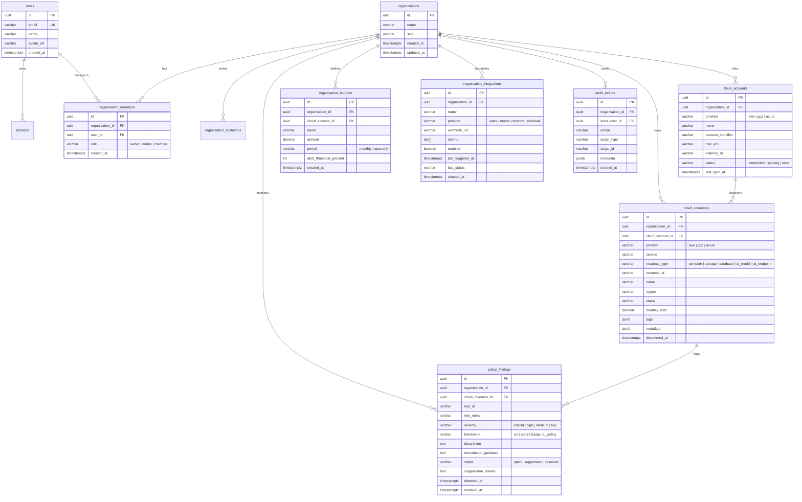

# Database Schema & Multi-Tenancy

CloudPilot relies on **PostgreSQL 16+** as its primary system of record. All tenant infrastructure telemetry, cost metrics, policy findings, and user memberships are stored and queried using direct, parameterized SQL via `github.com/jackc/pgx/v5`.

---

## 1. Entity-Relationship Diagram (ERD)



---

## 2. Migration Sequence

Migrations are embedded directly into the Go binary via `embed.FS` in `backend/internal/migrations`. On API startup, `migrations.Apply` ensures the `schema_migrations` tracking table exists, reads the directory in alphabetical order, and executes unapplied migrations within a single atomic transaction:

| Migration File | Description | Key Changes |
| :--- | :--- | :--- |
| `001_initial.sql` | Core identity & tenancy | Tables: `users`, `sessions`, `organisations`, `organisation_members`, `audit_events`. |
| `002_auth.sql` | OIDC authorization extensions | Stores refresh tokens, PKCE code verifier, and provider state. |
| `003_cloud_governance.sql` | Multi-cloud inventory schema | Tables: `cloud_accounts`, `cloud_resources`, `policy_findings`. Adds indexes on `organisation_id` and `resource_type`. |
| `004_finops_budgets.sql` | FinOps budget tracking | Table: `organisation_budgets` with alert threshold triggers. |
| `005_fix_auth_sessions.sql` | Session performance optimization | Adds lookup indexes for session validation and auto-expiry cleanup. |
| `006_integrations.sql` | Webhook alerting pipeline | Table: `organisation_integrations` supporting Slack, Teams, and Discord. |
| `007_cleanup_secondary_org_sample_data.sql` | Multi-tenancy integrity | Purges duplicate sample records from secondary workspaces to preserve clean zero-states. |
| `008_seed_primary_sample_integration.sql` | Onboarding telemetry | Seeds initial Slack integration for the primary demo tenant. |

---

## 3. Multi-Tenancy & Query Scoping

Every table containing business telemetry holds a mandatory `organisation_id UUID NOT NULL REFERENCES organisations(id) ON DELETE CASCADE`.

### Query Scoping Rules:
1. **Never query without `organisation_id`**: All `SELECT`, `UPDATE`, and `DELETE` queries must bind the tenant ID as parameter `$1`.
2. **Cascading Deletions**: When a cloud account is disconnected, all child records in `cloud_resources` and `policy_findings` are automatically deleted via `ON DELETE CASCADE`.
3. **No Cross-Tenant Leaks**: Primary keys are UUIDs, preventing sequential ID probing attacks.

```sql
-- Example: Scoped spend aggregation by cloud provider
SELECT 
    provider, 
    COALESCE(sum(monthly_cost), 0.00) AS total_spend
FROM cloud_resources
WHERE organisation_id = $1::uuid
GROUP BY provider
ORDER BY total_spend DESC;
```

---

## 4. Indexing Strategy

To support high-throughput telemetry updates and responsive sub-50ms dashboard aggregations, the schema includes targeted B-tree and GIN indexes:

- `CREATE INDEX idx_cloud_resources_org_type ON cloud_resources(organisation_id, resource_type);`
- `CREATE INDEX idx_cloud_resources_org_cost ON cloud_resources(organisation_id, monthly_cost DESC);`
- `CREATE INDEX idx_policy_findings_org_status ON policy_findings(organisation_id, status, severity);`
- `CREATE INDEX idx_audit_events_org_created ON audit_events(organisation_id, created_at DESC);`
- `CREATE INDEX idx_cloud_resources_tags_gin ON cloud_resources USING gin (tags);`
