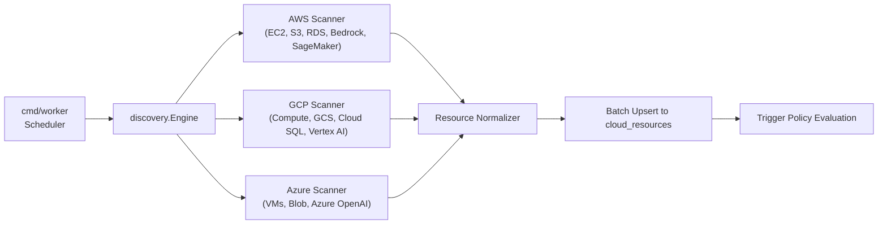
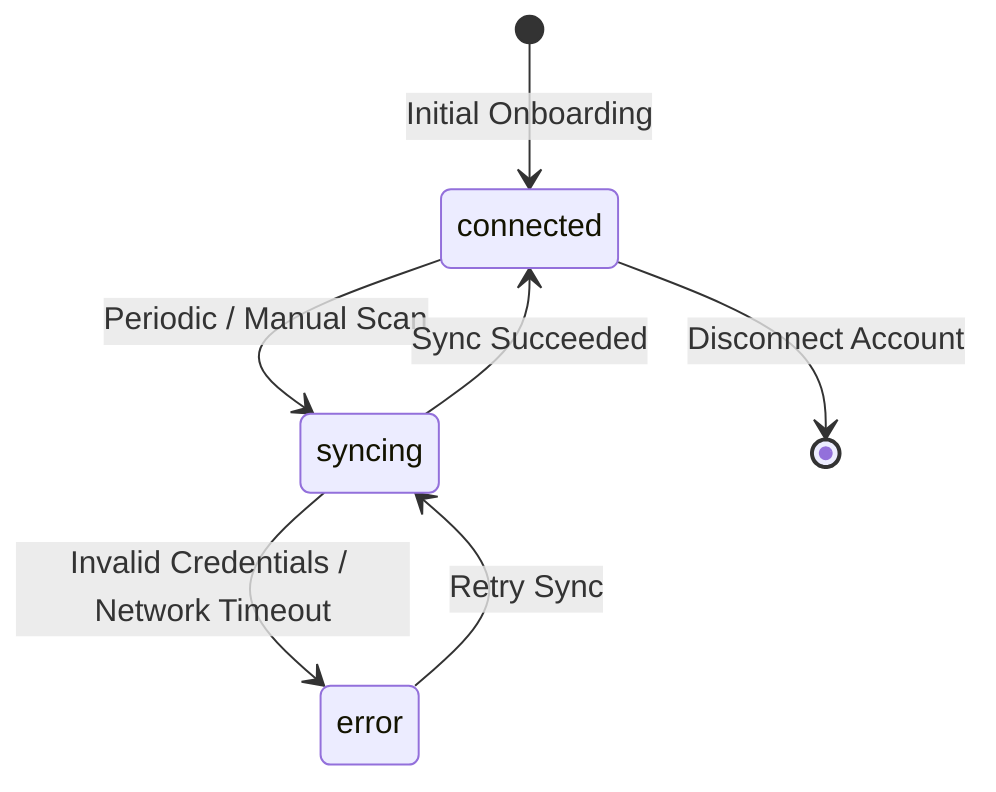

# Discovery & FinOps Engine

CloudPilot includes an autonomous multi-cloud discovery engine and a FinOps analytics pipeline designed to reconcile infrastructure inventories and normalize billing telemetry across disparate cloud providers.

---

## 1. Cloud Discovery Engine

The discovery engine resides in `backend/internal/discovery` and operates via a unified Go interface:

```go
type Scanner interface {
    Provider() string
    Scan(ctx context.Context, account CloudAccount) ([]DiscoveredResource, error)
}
```



### 1.1 Provider Scanners

| Provider | Services Discovered | Normalization Output |
| :--- | :--- | :--- |
| **AWS** | • Amazon EC2 Instances<br/>• Amazon S3 Buckets<br/>• Amazon RDS Databases<br/>• Amazon Bedrock Foundation Models<br/>• Amazon SageMaker Inference Endpoints | Normalized to `cloud_resources` with `provider: 'aws'`, tags, metadata (e.g. `kmsKey`, `invocationLogging`), and monthly run-rate. |
| **GCP** | • Google Compute Engine VMs<br/>• Google Cloud Storage (GCS)<br/>• Cloud SQL PostgreSQL/MySQL<br/>• Vertex AI Gemini & Custom Endpoints | Normalized with `provider: 'gcp'`, project identifiers, and model parameters. |
| **Azure** | • Azure Virtual Machines<br/>• Azure Blob Storage Containers<br/>• Azure Database for PostgreSQL<br/>• Azure OpenAI Service Deployments | Normalized with `provider: 'azure'`, resource groups, and subscription tags. |

### 1.2 Account Lifecycle & States

Every connected cloud account cycles through predictable states tracked in `cloud_accounts.status`:



---

## 2. Background Discovery Worker (`cmd/worker`)

The discovery worker runs as a dedicated daemon alongside the API:

1. **Scheduled Interval**: Periodically queries `cloud_accounts` across all organizations that haven't been synchronized within the refresh window (default: every 10 minutes).
2. **Account Locking**: Enforces single-concurrency scans per cloud account to avoid race conditions.
3. **Database Reconciler**: 
   - Inserts newly detected resources.
   - Updates status and monthly cost for existing resources.
   - Removes resources that no longer exist in the target cloud.
4. **Automated Policy Trigger**: Upon scan completion, the worker invokes `policy.Engine.EvaluateAccount` to immediately test newly discovered assets against security and compliance guardrails.

---

## 3. FinOps & Cost Intelligence (`internal/finops`)

The FinOps module provides enterprise cost visibility and autonomous anomaly detection.

### 3.1 Historical Cost Time-Series Aggregation
- Generates a **30-day continuous daily spend series** isolating Core Infrastructure from AI Workloads.
- Incorporates diurnal and weekend traffic modulation factors for realistic forecasting.
- Calculates Month-to-Date (MTD) run rate, previous month comparison, and projected end-of-month spend.

### 3.2 Automated Cost Anomaly Detection
CloudPilot runs continuous anomaly detection over discovered assets:
- **Detection Algorithm**: Flags resources whose actual monthly run rate exceeds expected baseline levels by $>30\%$.
- **AI Token Velocity Anomalies**: Specifically identifies foundation model endpoints generating uncharacteristic token surges.
- **Root Cause Context**: Attaches actionable remediation guidance (e.g. downscaling idle SageMaker endpoints, enabling prompt caching for repetitive Claude prompts, or cleaning unattached EBS volumes).

### 3.3 Budget Governance & Alerts
Workspaces can define monthly financial limits via `organisation_budgets`:

- **Status: `ok`**: Spend is within normal parameters (`< AlertThresholdPercent`).
- **Status: `warning`**: Spend has crossed the alert threshold (e.g. $>80\%$). Dispatches webhook alert.
- **Status: `exceeded`**: Current spend exceeds $100\%$ of budget. Triggers critical alert to configured channels.
