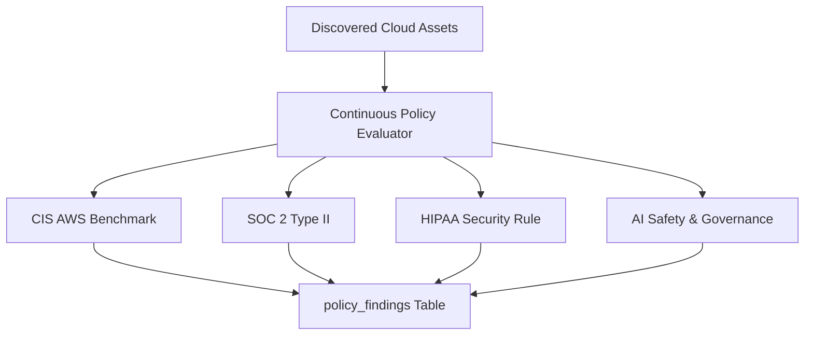
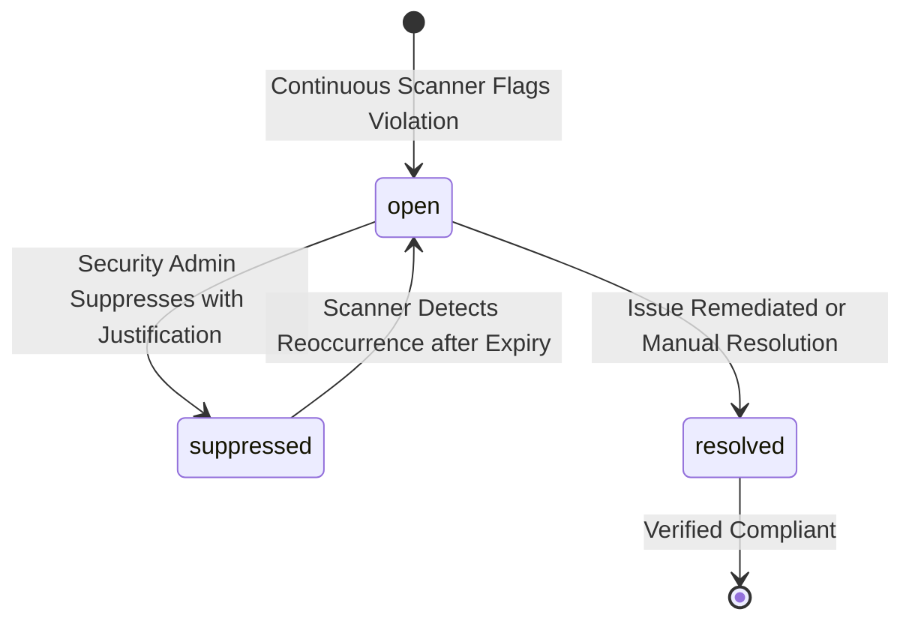

# Security & Policy Guardrails

CloudPilot provides continuous, autonomous compliance auditing across multi-cloud environments. The policy engine evaluates infrastructure assets and AI model deployments against security frameworks and corporate safety guardrails.

---

## 1. Compliance Frameworks & Rules Catalog

The policy engine (`backend/internal/policy`) tests resources against standardized rule sets:

### 1.1 CIS Benchmarks & Cloud Security Posture
- **`cis-s3-public-access` (Critical)**: Flags S3 buckets or Cloud Storage buckets with public read/write ACLs or missing `BlockPublicAccess` configurations.
- **`cis-storage-encryption` (High)**: Ensures all object storage buckets and disk volumes enforce default server-side encryption (KMS CMK).
- **`cis-sg-open-ingress` (Critical)**: Detects security groups allowing unrestricted ingress (`0.0.0.0/0`) on sensitive management ports (SSH `22`, RDP `3389`).
- **`cis-db-public-access` (Critical)**: Verifies relational database instances (RDS, Cloud SQL) are placed in private subnets with public access disabled.

### 1.2 SOC 2 & HIPAA Governance
- **`soc2-audit-logging` (High)**: Enforces API trail and audit logging across all cloud accounts.
- **`hipaa-kms-cmk` (Critical)**: Mandates customer-managed encryption keys (AWS KMS / Google Cloud KMS) for sensitive data buckets.

### 1.3 AI Workload Safety Guardrails
- **`ai-guardrail-pii` (High)**: Verifies foundation models and Bedrock/Vertex inference endpoints have PII masking or prompt redacting enabled.
- **`ai-guardrail-logging` (Medium)**: Ensures invocation and audit logging is active for LLM endpoints to preserve traceability.
- **`ai-guardrail-endpoint-auth` (Critical)**: Flags public unauthenticated AI inference endpoints.

---

## 2. Policy Finding Lifecycle

1. **Detection**: Discovered assets are evaluated upon every sync. Open findings are saved to `policy_findings` with severity (`critical`, `high`, `medium`, `low`).
2. **Triage**:
   - **Suppress**: If an intentional architectural exception exists, users can suppress the finding by providing an audit justification (`POST /api/v1/policies/findings/{id}/suppress`).
   - **Resolve**: Users can mark findings resolved manually or execute automated remediation scripts generated by the AI Copilot.

---

## 3. Platform & Session Security Model

CloudPilot is architected with a defense-in-depth security model:

### 3.1 Pure OIDC Authentication
- Uses standard OpenID Connect with PKCE (Proof Key for Code Exchange).
- Eliminates local credential storage; user passwords never touch the platform.

### 3.2 Host-Only `HttpOnly` Cookies
- The authentication token is held in a secure, `HttpOnly`, `SameSite=Lax` cookie (`cp_session`).
- **Zero LocalStorage Tokens**: JavaScript running in the browser cannot access or exfiltrate session credentials, neutralizing XSS credential theft.

### 3.3 Multi-Tenant RBAC Matrix

| Capability | Owner | Admin | Member |
| :--- | :---: | :---: | :---: |
| View Dashboards, Inventory, & Costs | Yes | Yes | Yes |
| Ask AI Copilot & View Findings | Yes | Yes | Yes |
| Suppress / Resolve Policy Findings | Yes | Yes | No |
| Connect / Sync / Disconnect Cloud Accounts | Yes | Yes | No |
| Manage Webhook Integrations | Yes | Yes | No |
| Invite / Remove Team Members | Yes | Yes | No |
| Change Member Roles | Yes | No | No |
| Delete Organisation Workspace | Yes | No | No |

### 3.4 AWS STS External ID Security
When connecting AWS accounts via IAM cross-account roles, CloudPilot automatically generates a high-entropy, unique external ID (`cp-ext-...`). This prevents the **Confused Deputy** problem in multi-tenant environments.

### 3.5 Webhook URL Masking
Webhook target URLs (e.g. `https://hooks.slack.com/services/T00/B00/XXXX`) are automatically masked in all API responses (`https://hooks...XXXX`) to prevent secret leakage in browser logs.
